# Application deployment

The **Apps** view creates a deployment of an application for a device collection.

## What it does

You pick an application and a device collection, choose the purpose and the schedule, and select **Validate**. Five checks run. When all pass, the **Deploy** button shows. **Deploy** asks for a confirmation and then creates the deployment and writes one record to the audit log.

## When to use it

Use it to deploy an application with checks and a log. The other types use the same form. See [Packages, task sequences and software update groups](other-types.md).

## Requirements

- A connection. See [Getting started](../getting-started.md).
- The right to create application deployments.

## Steps

### Fill the form

1. Type the application name in **Application**, or select **Browse...**. The dialog `Browse applications` loads the full list in the background. A filter box narrows the list as you type.

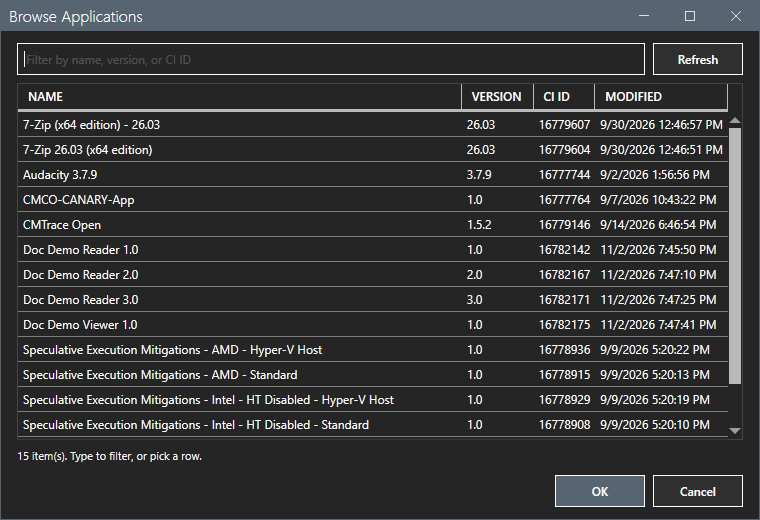

2. Type the collection name in **Collection**, or select **Browse...**. The dialog `Pick device collection` shows the collections in their console folders. A folder is not selectable.

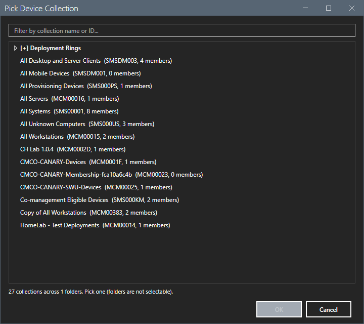

3. Select the purpose, **Available** or **Required**. **Required** shows the **Deadline** field.
4. Set **Available** and **Deadline**, the **Notification** and the **Time basis**, **Local time** or **UTC**.

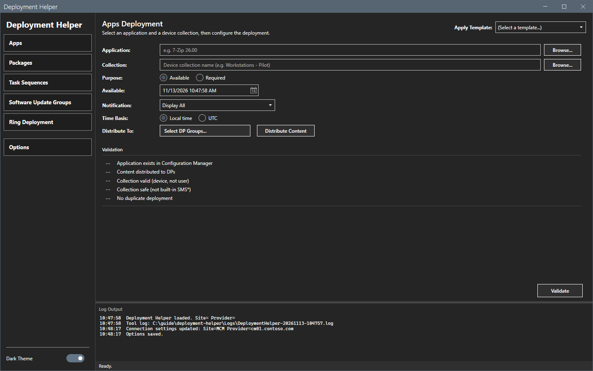

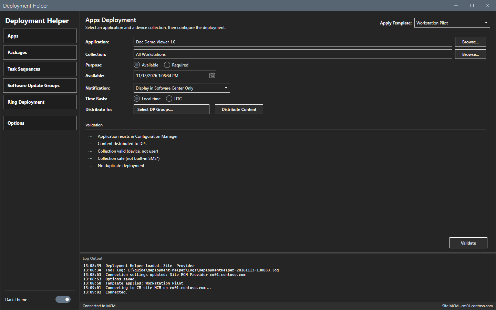

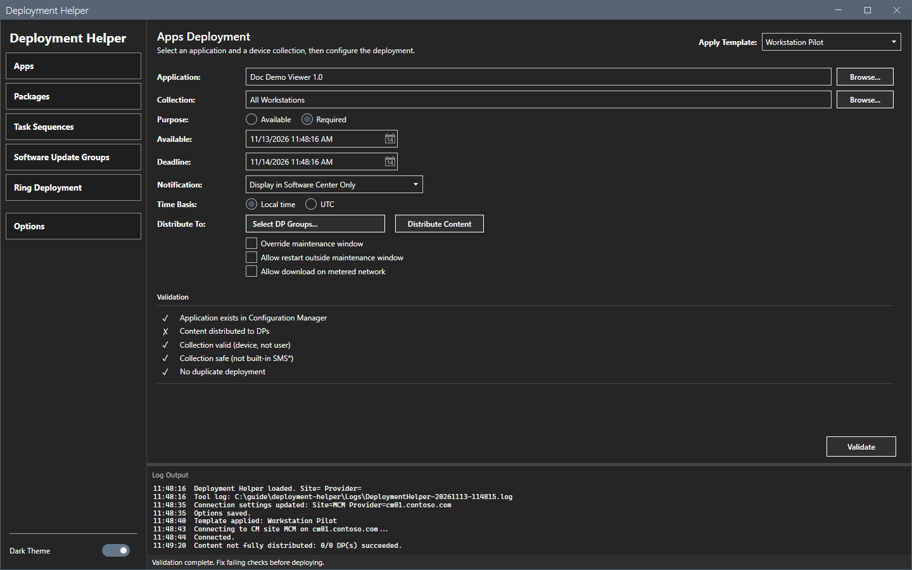

### Apply a template

1. Open the **Apply template** list at the top right.

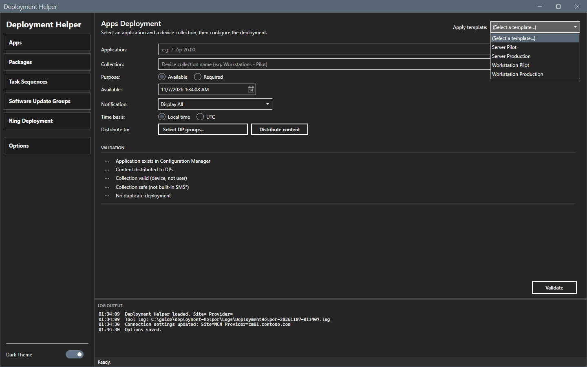

2. Select a template. The tool fills the purpose, the notification, the time basis and the options from the template.

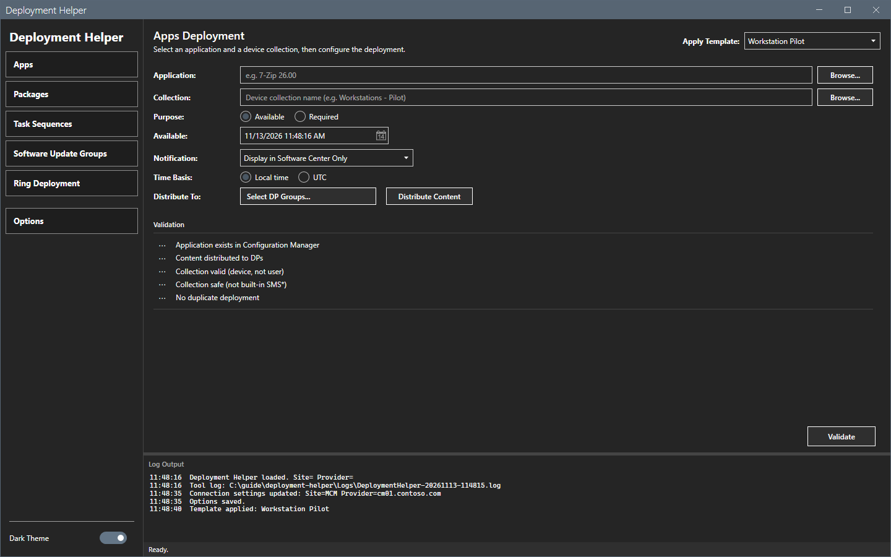

### Run the five checks

Select **Validate**. The tool runs these checks in order:

1. The application exists in Configuration Manager.
2. The content is distributed to distribution points.
3. The collection is valid: a device collection, not a user collection.
4. The collection is safe: not a built-in collection whose ID starts with `SMS`.
5. No duplicate deployment of this application to this collection exists.

A check mark means pass and a cross means fail. The status bar shows `Validation complete. Fix failing checks before deploying.` or `All checks passed. Ready to deploy.`

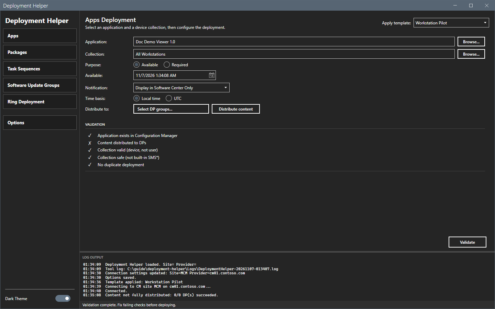

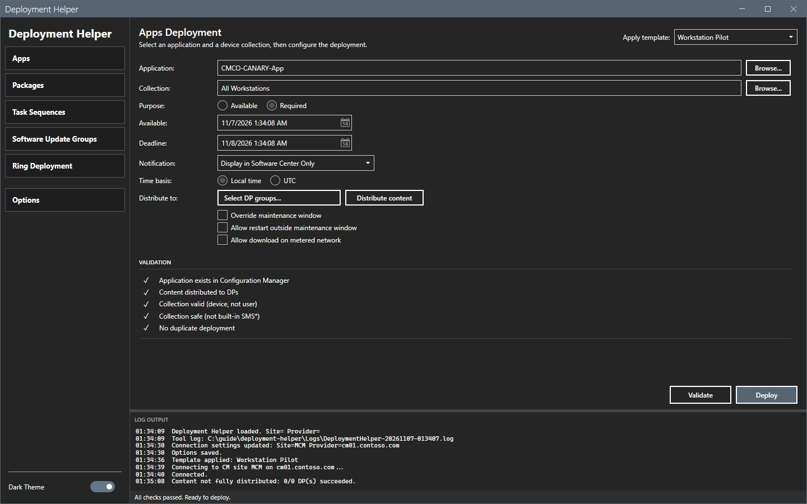

### Distribute content

If the content check fails, select **Select DP groups...** and check the groups. Groups that already have the content are checked. Then select **Distribute content**. A checked group can still be distributing the content, and a check mark does not confirm that the distribution is complete. Wait until the distribution is complete, then select **Validate** again. This guide did not distribute content.

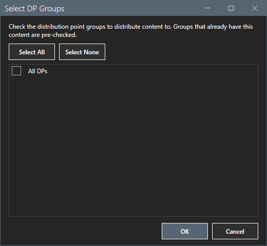

### Create the deployment

1. Select **Deploy**. The tool checks the schedule. A deadline before the available time stops the step with the message `Deployment blocked`. A backdated available time asks `Check deployment schedule` with **Yes** and **No**.
2. The dialog `Confirm deployment` shows the object, the collection with its member count and the purpose. Select **OK** to create the deployment or **Cancel**.

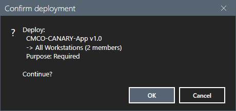

3. After **OK**, the tool checks that the audit log can be opened for writing, creates the deployment and then writes the audit record. The tool blocks the deployment before it creates it when the duplicate check cannot run or the audit log check fails. If the audit record cannot be written after the site created the deployment, the tool reports the deployment ID. The deployment stays. The tool does not undo it.

This guide opened the dialog and selected **Cancel**. It did not create a deployment. The result of **OK** was not checked.

## Options and settings of this page

| Control | Effect |
|---|---|
| **Apply template** | Fills the form from a template. |
| **Browse...** | Opens a list of the objects or collections of the site. |
| **Available**, **Required** | Set the purpose. |
| **Available**, **Deadline** | Set the dates. |
| **Notification** | The user experience of the deployment. |
| **Local time**, **UTC** | The time basis of the dates. |
| **Select DP groups...**, **Distribute content** | Choose distribution point groups and distribute the content. |
| **Override maintenance window**, **Allow restart outside maintenance window**, **Allow download on metered network** | Options of a Required deployment. |
| **Validate** | Runs the five checks. |
| **Deploy** | Confirms and creates the deployment. It shows after all checks pass. |

## Limits

- The tool blocks a combination of **Available** with a notification that hides everything, because the deployment would do nothing.
- Lists are kept for the session. Select **Refresh** in the dialog, or Shift+**Browse...** for collections, to read them again.
- The check `Content distributed to DPs` fails for an application whose content is on no distribution point.

## Troubleshooting

| Message or symptom | Cause | Fix |
|---|---|---|
| The **Deploy** button is missing. | Not all checks passed, or no validation ran. | Select **Validate** and fix the failing checks. |
| The log shows `Run Validate first.` | **Deploy** ran without a validation. | Select **Validate**. |
| The log shows `Content not fully distributed: 0/0 DP(s) succeeded.` | The content is on no distribution point. | Select the DP groups and **Distribute content**. |
| `Deployment blocked` | The schedule or the notification is not valid. | Read the text of the dialog and change the form. |

## Links

- [Ring deployment](rings.md)
- [Options dialog](options.md)
- [Error messages](../reference/error-messages.md)
