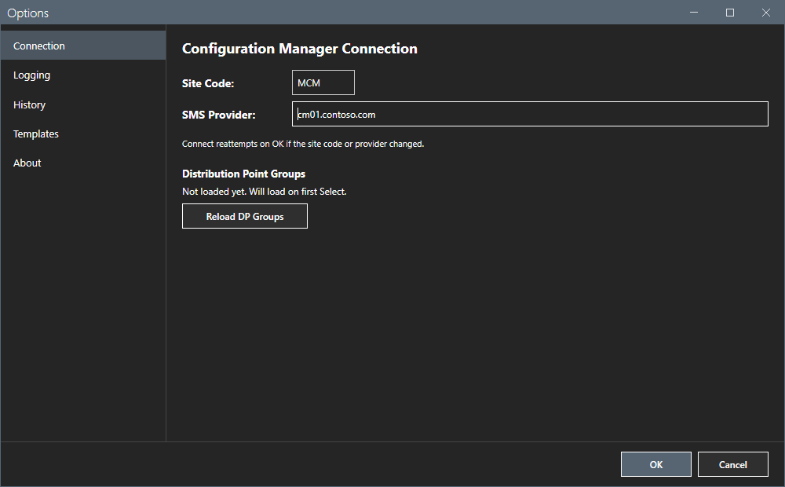
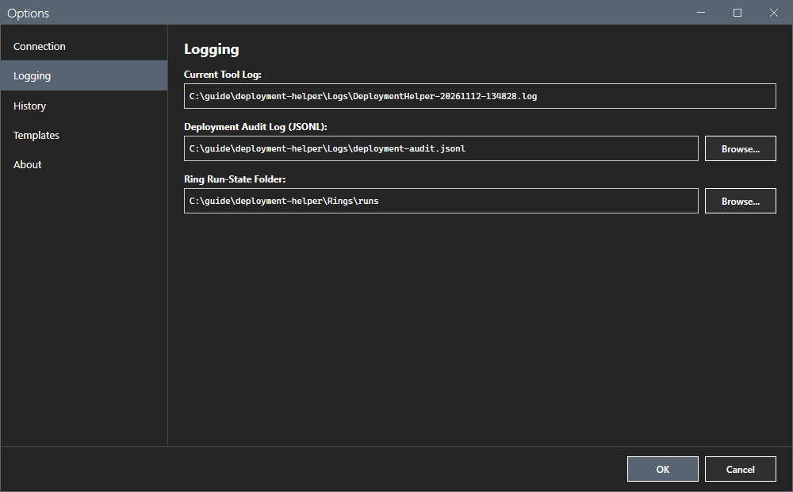
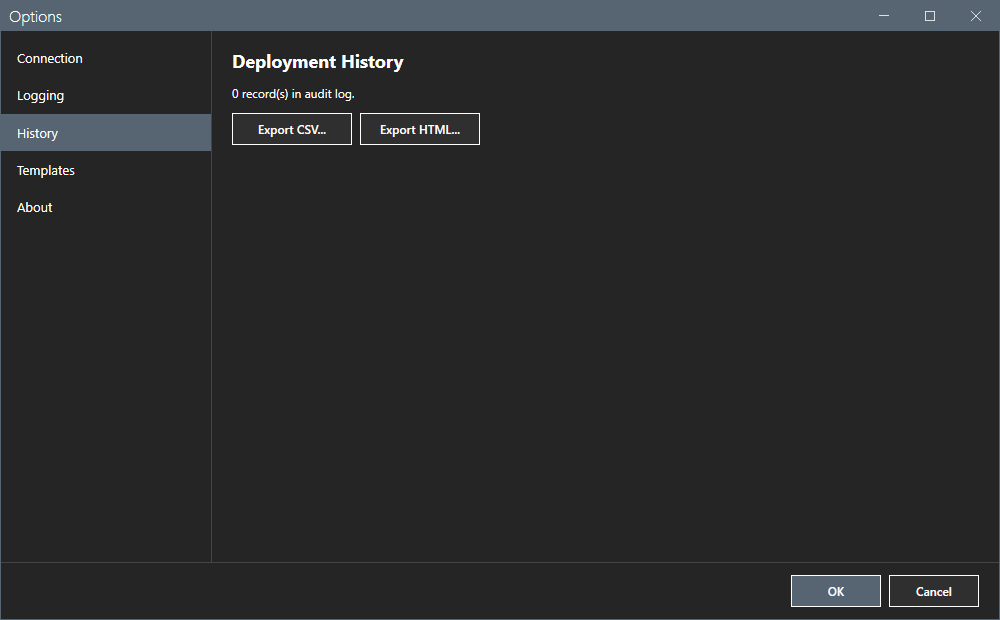
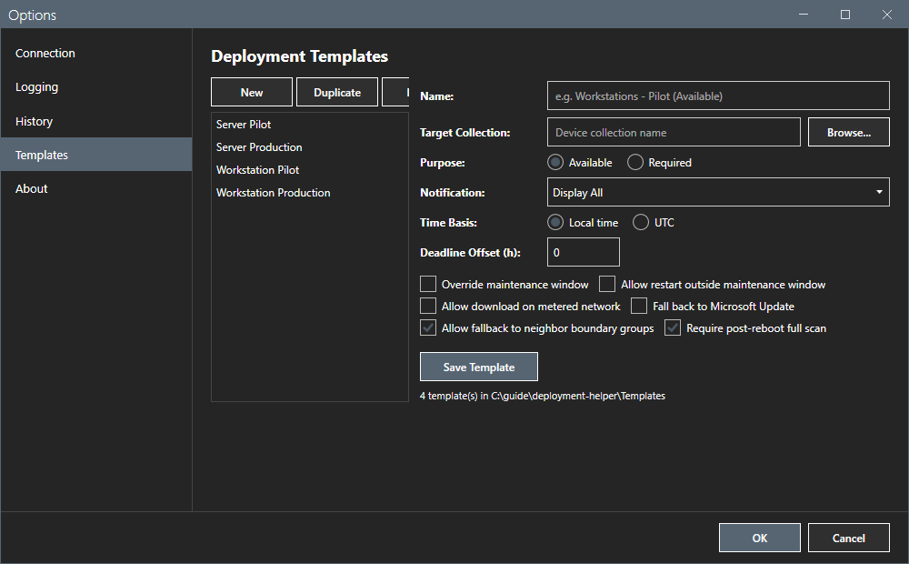
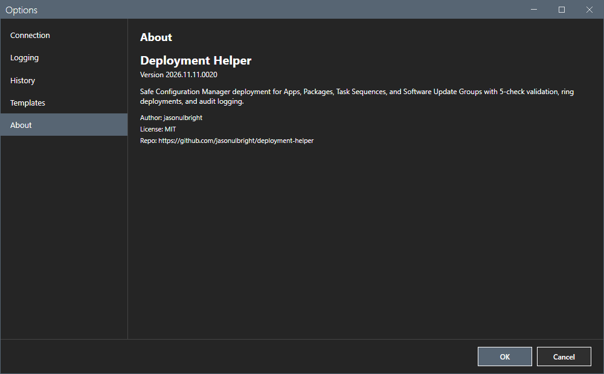
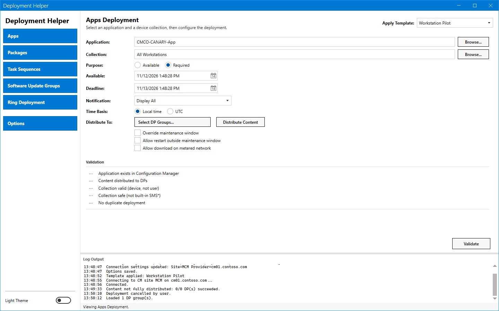
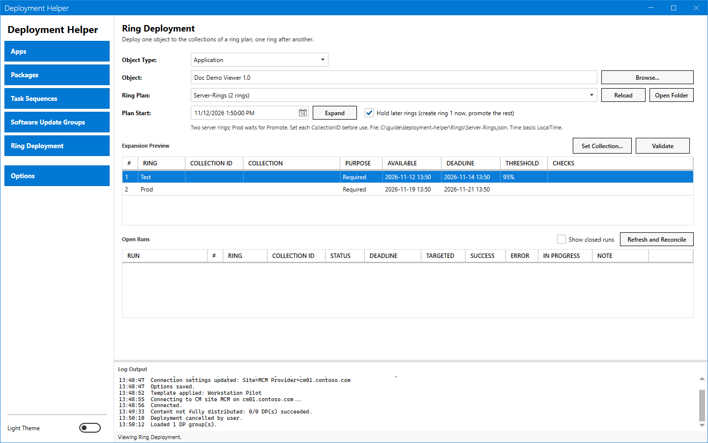
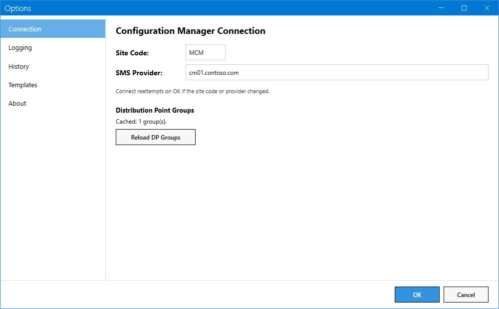
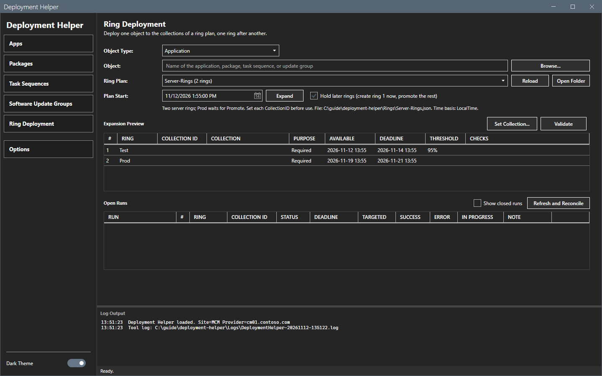

# Options dialog

The Options dialog sets the connection, the log paths, the history exports and the deployment templates.

## What it does

The dialog has five pages: **Connection**, **Logging**, **History**, **Templates** and **About**. **OK** saves. **Cancel** closes the dialog and keeps the old values of the Connection and Logging pages. It does not undo template changes: **Save Template**, **New**, **Duplicate** and **Delete** take effect at once.

## When to use it

Use it at the first start, to move the audit log or the ring run folder, to export the history and to edit the templates.

## Requirements

None.

## Steps

### Connection

| Field | Meaning |
|---|---|
| **Site Code** | The site code, for example `MCM`. The title is bold at 14 pt in both themes. |
| **SMS Provider** | The server with the SMS Provider role. The title is bold at 14 pt in both themes. |
| **Reload DP Groups** | Reads the distribution point groups again. |

**OK** disconnects the current connection when the site code or the provider changed. The next action that needs a connection connects again with the saved settings.

### Logging

The page shows the path of the current tool log, the path of the deployment audit log (JSONL) and the ring run-state folder. Select **Browse...** to change the last two. A UNC path for the run-state folder lets a team share runs.

### History

The page shows the number of records in the audit log. **Export CSV...** and **Export HTML...** save the history to a file. This guide did not export the history.

### Templates

The list shows the deployment templates. **New**, **Duplicate** and **Delete** change the list. Select a template to edit its name, target collection, purpose, notification, time basis, deadline offset in hours and options, and select **Save Template**. Each template is a JSON file in `Templates`.

### About

The page shows the version and a short description.

### Theme

The **Dark Theme** switch at the bottom of the sidebar changes the theme. The tool keeps the choice. The theme changes colors only. Font size, weight and style stay the same. Every blue background has white text, and the titles of fields are bold.

### Start again

The tool saves the window place and the last used deployment type. After a restart the window shows the same view.

## Options and settings of this page

See the tables above. [Settings](../reference/settings.md) lists the file keys.

## Limits

- The templates are files. Edits survive a restart.
- The audit log is append-only. The tool does not delete records.

## Troubleshooting

| Message or symptom | Cause | Fix |
|---|---|---|
| The Deploy button gives `Audit Log Write Failed`. | The tool cannot write the audit log path. | Set a writable path on the **Logging** page. |

## Links

- [Settings](../reference/settings.md)
- [Getting started](../getting-started.md)
