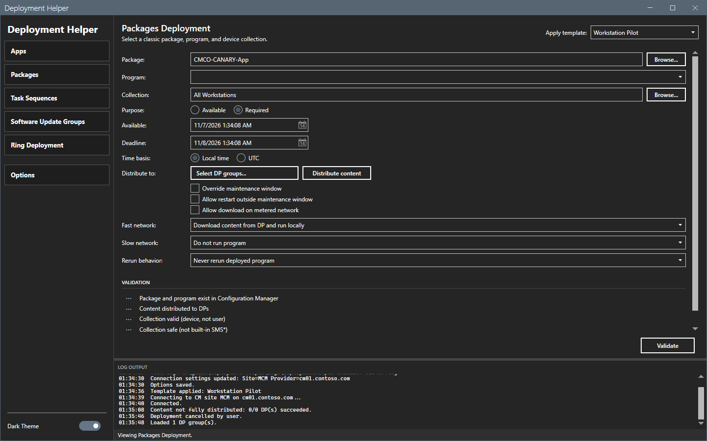
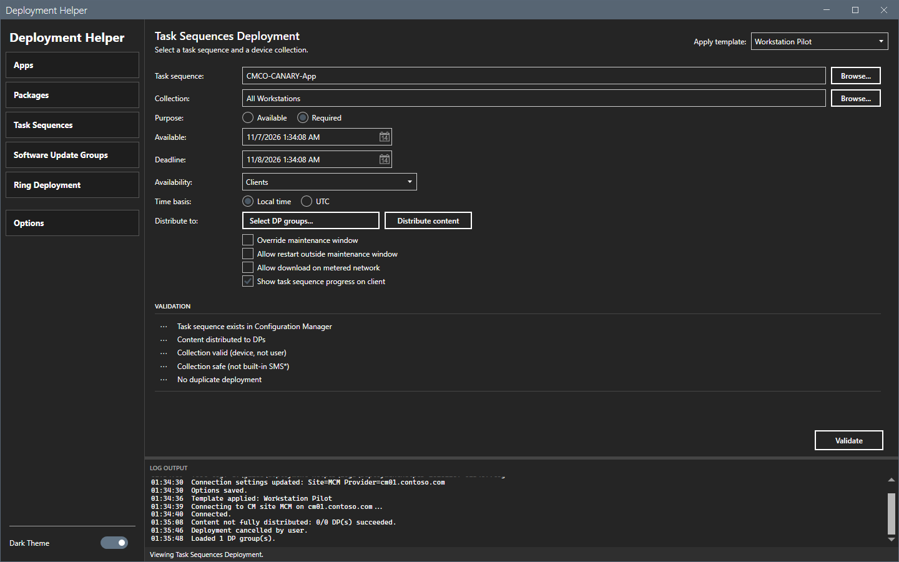
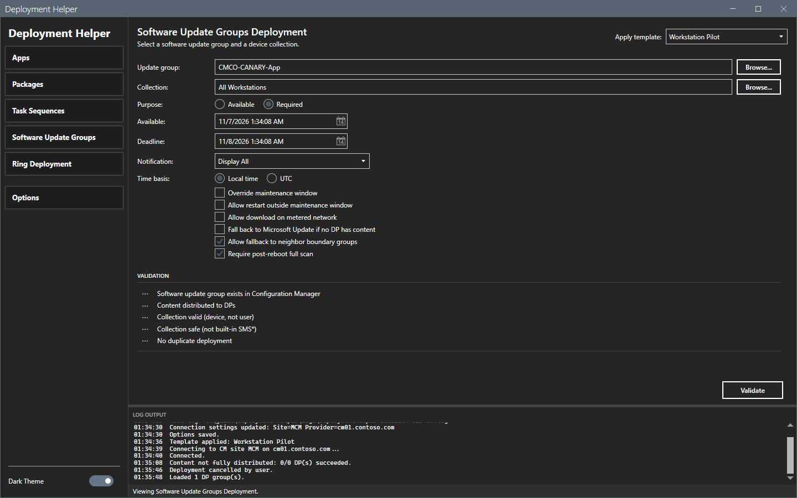

# Packages, task sequences and software update groups

The **Packages**, **Task Sequences** and **Software Update Groups** views use the same form as [Application deployment](apps.md), with the fields of their own type.

## What it does

Each view picks an object and a device collection and runs five checks before it creates the deployment. The first check names the type: `Package and program exist`, `Task sequence exists` or `Software update group exists`. The other four checks are the same.

## When to use it

Use it to deploy a classic package and program, a task sequence or a software update group with checks and a log.

## Requirements

- A connection. See [Getting started](../getting-started.md).
- The right to create deployments of the type.

## Steps

### Packages

1. Select **Packages** in the sidebar.
2. Select the package, then select its program in **Program**. Select the collection, the purpose and the dates.
3. Set **Fast network**, **Slow network** and **Rerun behavior**.
4. Select **Validate**, then **Deploy**.

### Task sequences

1. Select **Task Sequences** in the sidebar.
2. Select the task sequence and the collection. Set **Availability**. The options include **Show task sequence progress on client**.
3. Select **Validate**, then **Deploy**.

### Software update groups

1. Select **Software Update Groups** in the sidebar.
2. Select the update group and the collection. The options include **Fall back to Microsoft Update if no DP has content**, **Allow fallback to neighbor boundary groups** and **Require post-reboot full scan**.
3. Select **Validate**, then **Deploy**.

This guide opened the three forms. It did not run the checks or deploy on them. The images show the text that the form kept from the Apps view: the object name and the collection do not clear when you change the type.

## Options and settings of this page

The controls are those of [Application deployment](apps.md), plus:

| Control | Type | Effect |
|---|---|---|
| **Program** | Package | The program to deploy. |
| **Fast network**, **Slow network**, **Rerun behavior** | Package | How the client downloads and reruns the program. |
| **Availability** | Task sequence | The clients or media that get the task sequence. |
| **Show task sequence progress on client** | Task sequence | Shows the progress. |
| **Fall back to Microsoft Update if no DP has content** and the next two | Software update group | Fallback and scan options. |

## Limits

- The object field and the collection field keep their text when you change the type. Clear them before you validate.
- A software update group has no **Distribute to** line.

## Troubleshooting

| Message or symptom | Cause | Fix |
|---|---|---|
| The first check fails. | The text in the object field is not an object of this type. | Select the object with **Browse...**. |

## Links

- [Application deployment](apps.md)
- [Ring deployment](rings.md)
