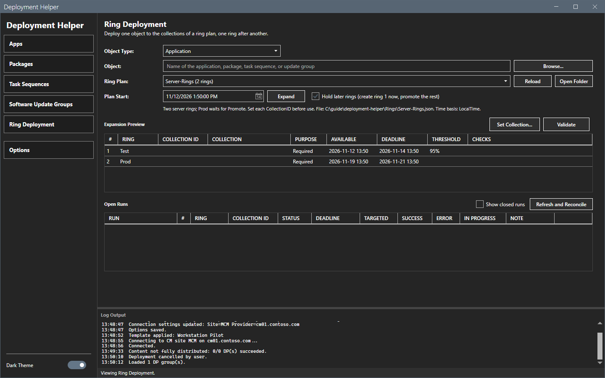
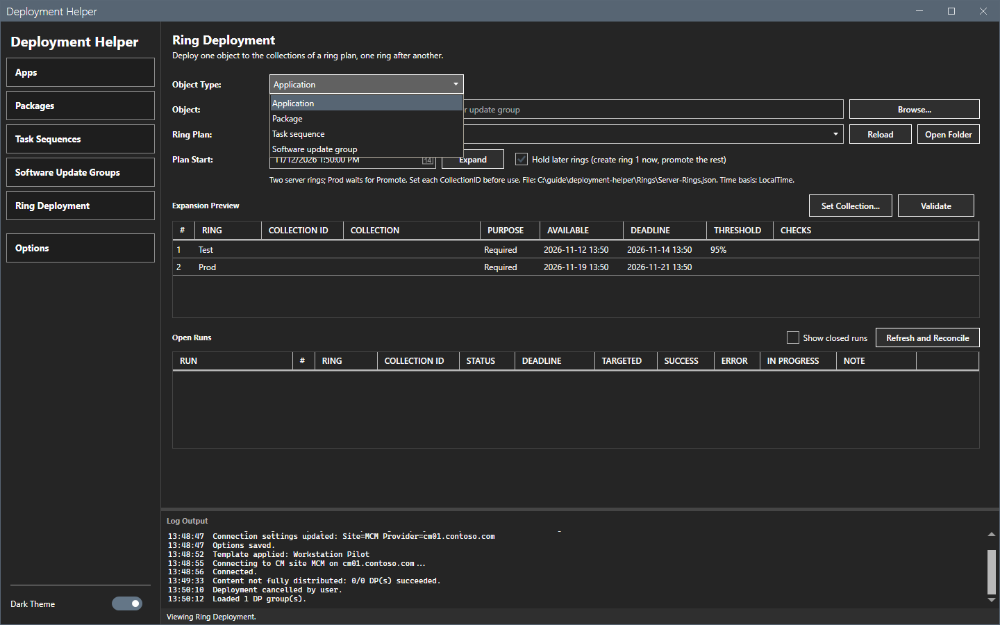
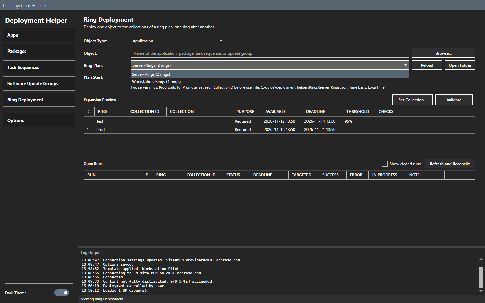
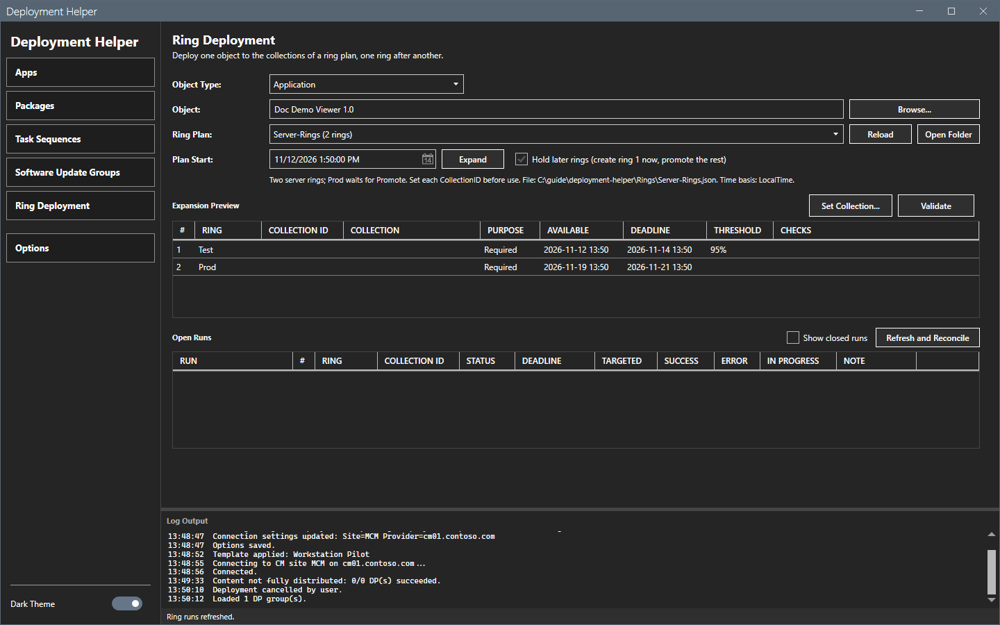

# Ring deployment

The **Ring Deployment** view deploys one object to the collections of a ring plan, one deployment for each ring.

## What it does

A ring plan is a named, ordered list of rings in `Rings\<plan>.json`. Each ring names one device collection by its ID, a purpose and day offsets from the plan start. A ring run creates one ordinary Configuration Manager deployment for each ring. The site does not know that the deployments form a sequence. Only the files of the tool record it.

## When to use it

Use it to roll an application, a package, a task sequence or a software update group out in steps, for example QA, Pilot and Production.

## Requirements

- A connection. See [Getting started](../getting-started.md).
- A ring plan with a collection for each ring. The two plans that the tool writes at the first start, **Workstation-Rings** and **Server-Rings**, name no collection. A plan with an empty ring target does not run.
- The right to create deployments of the type that you use.

## Steps

### Open the view

Select **Ring Deployment** in the sidebar.

### Pick the object and the plan

1. Open the **Object Type** list and select **Application**, **Package**, **Task Sequence** or **Software Update Group**.

2. Type the object name in **Object**, or select **Browse...**. For a package, select the program.
3. Open the **Ring Plan** list and select a plan. **Reload** reads the plan files again. **Open Folder** opens the `Rings` folder.

4. Set the **Plan Start**. Select **Hold later rings** to create ring 1 now and promote the others later.

### Expand and check the plan

1. Select **Expand**. The preview lists each ring with the collection ID, the collection, the purpose, the available time, the deadline, the threshold and the checks.

2. Select a ring and select **Set Collection...** to set its collection for this run. Edits in the preview apply to this run only. Or set `CollectionID` in the plan file.
3. Select **Validate**. Each ring must pass the five checks of [Application deployment](apps.md) and the plan rules.
4. Select **Create Deployments**. The confirmation lists every deployment that the run creates.

This guide expanded a plan. It did not validate a plan with collections and did not create deployments. The behavior of **Validate**, **Create Deployments** and Promote was read from the README and the code only.

### Plan rules

- Rings must not share a collection.
- A built-in collection (ID prefix `SMS`) is blocked. A plan file that names one does not load. The log names the ring.
- The deadline of a Required ring must be later than its available time and later than the deadline of the previous Required ring.
- A deadline in the past blocks the run.

For a plan with `"TimeBasedOn": "Utc"`, enter the plan start and every preview time in UTC.

### Create all rings at once

This is the default. The tool creates every ring now, with future available times and deadlines. Configuration Manager enforces the schedule. If one ring fails, the run stops. The rings that the tool created before it stay.

### Hold later rings

With **Hold later rings**, or `"HoldLaterRings": true` in the plan, the tool writes a run file, records ring 1 as creating and creates it. The other rings stay held.

**Open Runs** shows each ring of each open run with live counts from the site: targeted, success, error and in progress. **Promote** on the next held ring creates it after the five checks run again. Promote reads the run file again first. It refuses when the ring is no longer held or when another session holds the run lock. `SuccessThresholdPercent` of a ring is the success rate that the ring must reach before Promote is available for the next ring. Promote never runs by itself.

If the deadline of a held ring has passed when you promote it, Promote moves that ring and every later held ring later by the same amount. The confirmation shows the change.

### Refresh and Reconcile

Select **Refresh and Reconcile** to read the live counts. The site summarizes a new deployment on its own schedule. Until then the ring shows no counts, and a threshold on it keeps Promote disabled. Reconcile marks a ring **Removed** only when the deployment is gone from the site. It moves a finished run to the `closed` subfolder. Select **Show closed runs** to see finished runs.

### The plan file

A plan file has a name, a description, `HoldLaterRings`, `TimeBasedOn` (`LocalTime` or `Utc`) and a list of rings. Each ring has these fields:

| Ring field | Values |
|---|---|
| `Name`, `CollectionID` | The ring name and the collection ID. |
| `Purpose` | `Available` or `Required`. |
| `AvailableOffsetDays`, `DeadlineOffsetDays` | Days after the plan start. Decimals are allowed. `DeadlineOffsetDays` is required for `Required` rings. |
| `UserNotification` | `DisplayAll`, `DisplaySoftwareCenterOnly` or `HideAll`. |
| `OverrideServiceWindow`, `RebootOutsideServiceWindow`, `AllowMeteredConnection` | `true` or `false`. |
| `AllowBoundaryFallback`, `AllowMicrosoftUpdate`, `RequirePostRebootFullScan` | Software update groups only. |
| `TaskSequenceAvailability`, `ShowTaskSequenceProgress` | Task sequences only. |
| `FastNetworkOption`, `SlowNetworkOption`, `RerunBehavior` | Packages only. |
| `DPGroup` | The DP group that receives the content before the deployment of this ring is created. Not for software update groups. |
| `SuccessThresholdPercent` | Empty, or 0 to 100. |

Every ring deployment writes one audit record with `PlanName`, `RingIndex`, `RingName` and `RunId`. If the audit log cannot be opened for writing, the tool does not create the deployment.

## Options and settings of this page

| Control | Effect |
|---|---|
| **Object Type**, **Object**, **Browse...** | Pick the object. |
| **Ring Plan**, **Reload**, **Open Folder** | Pick, reload and find the plans. |
| **Plan Start**, **Expand** | Compute the dates of each ring. |
| **Hold later rings** | Create ring 1 now and promote the others later. |
| **Set Collection...**, **Validate**, **Create Deployments** | Set the collections, check and create. |
| **Refresh and Reconcile**, **Show closed runs** | Read the live counts and show finished runs. |

The run-state folder is set in [Options dialog](options.md). The default is `Rings\runs`.

## Limits

- The site does not group the ring deployments. Only the run files do.
- A read error never marks a ring Removed.
- The tool creates a ring only after the five checks pass for it.

## Troubleshooting

| Message or symptom | Cause | Fix |
|---|---|---|
| The preview shows no collection. | The seed plan names no collection. | Select **Set Collection...** or set `CollectionID` in the plan file. |
| Promote is disabled. | The ring before it has not reached its threshold, or the site has no counts yet. | Select **Refresh and Reconcile** later. |
| The log names a ring and the plan does not load. | The plan names a built-in collection. | Name a custom collection. |

## Links

- [Application deployment](apps.md)
- [Files and logs](../reference/files-and-logs.md)
