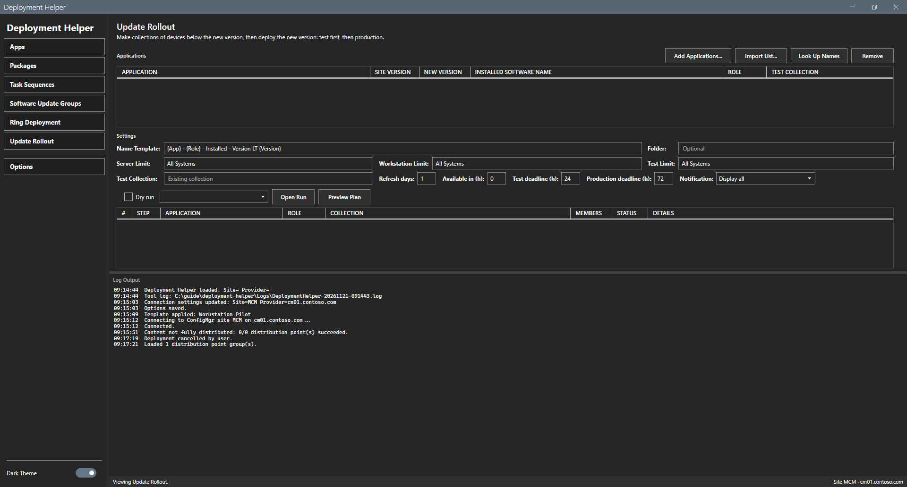
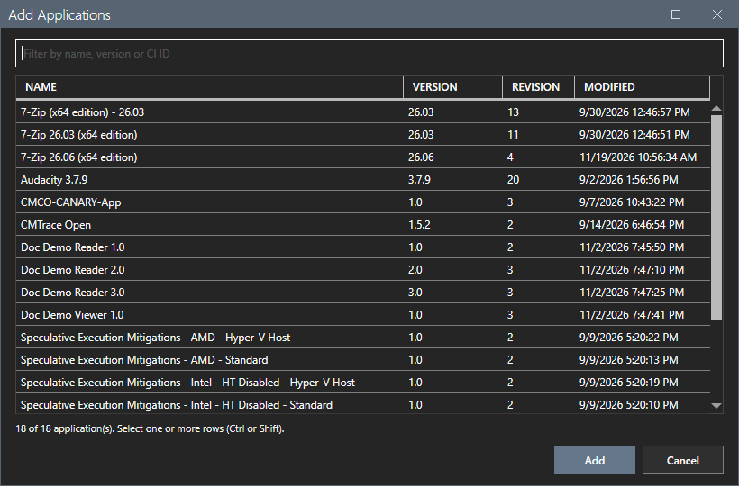
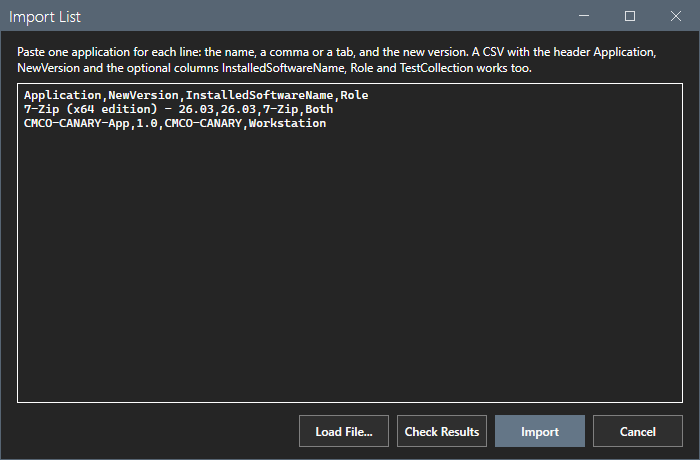
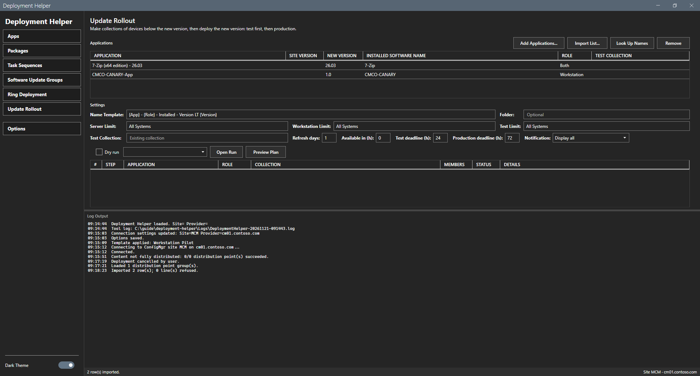
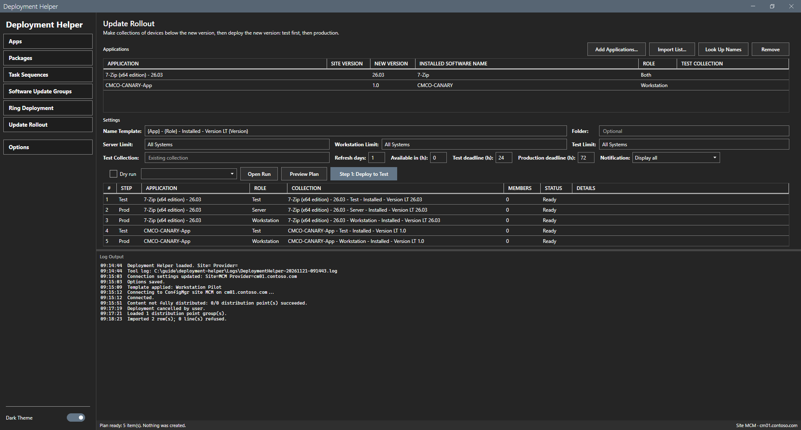
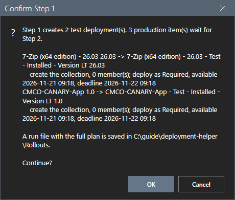

# Update rollout

The **Update Rollout** view updates many applications in two steps. For each application it makes device collections that hold the devices with an older version installed, and it deploys the new version to them. Step 1 deploys to a test target. Step 2 deploys to production.

## What it does

A rollout starts from a list of applications. Each row names an application, the new version (called XXX below) and the name of the installed software. The view builds these objects:

- A device collection named from a template. The default is `AppName - Server - Installed - Version LT XXX`. The query of the collection lists the devices that have the software installed with a version below XXX. A row with the role **Both** makes one collection for **Server** and one for **Workstation**.
- One Required deployment of the new application to each collection.

A test target comes first. The test target is an existing collection, or a collection that the view makes from the template with the role **Test**.

The view creates only the objects that its plan lists. The **Preview Plan** button shows the plan and changes nothing.

## When to use it

Use it to roll out the new versions of many applications that you have already added to Configuration Manager. Use [Ring deployment](rings.md) to roll out one object through several fixed collections.

## Requirements

- A connection. See [Getting started](../getting-started.md).
- The new version of each application is in Configuration Manager, and its content is distributed to the distribution points.
- The right to create device collections and deployments. See [Permissions](../reference/permissions.md).
- Hardware inventory of installed software is on for the clients (the classes `ADD_REMOVE_PROGRAMS` and `ADD_REMOVE_PROGRAMS_64`).

## Steps

### Open the view

Select **Update Rollout** in the sidebar.

### Add the applications

Add rows in one of two ways.

1. Select **Add Applications...**. The list shows the applications of the site with the newest revision and its version. Filter the list, select one or more rows and select **Add**. The new version of a row starts as the version of the application.

2. Select **Import List...**. Paste one application for each line (the name, a comma or a tab, and the new version), or load a CSV file. A CSV has the header `Application`, `NewVersion` and the optional columns `InstalledSoftwareName`, `Role` and `TestCollection`. The dialog refuses a line without a dotted version and names the line.
Select **Check Results** to fill the box with the updates that Check ConfigMgr found in App Packager or APD.

Then check each row in the grid:

| Column | Meaning |
|---|---|
| **Application** | The name of the application in the site. |
| **Site Version** | The version of the application in the site. Read-only. |
| **New Version** | XXX. A dotted number, for example `24.8` or `1.2.3.4`. |
| **Installed Software Name** | The name that the inventory shows in Programs and Features. A partial name matches. Select **Look Up Names** to read it from the inventory. |
| **Role** | **Server**, **Workstation** or **Both**. |
| **Test Collection** | An existing test collection for this row. Empty uses the setting. |

**Look Up Names** reads the name of the uninstall key from the detection data of the application, then looks it up in the inventory. Without a result it searches the inventory for the name of the application without its version. Check the result: a name that is too short matches other software.

### Set the settings

The **Settings** area keeps its values. The tool saves a value when you leave the box.

| Setting | Meaning |
|---|---|
| **Name Template** | The collection name. `{App}`, `{Role}` and `{Version}` are the placeholders. Default: `{App} - {Role} - Installed - Version LT {Version}`. |
| **Folder** | The console folder of new collections, below Device Collections, for example `Updates\2026`. The folder must exist. Empty means the root. |
| **Server Limit**, **Workstation Limit** | The limiting collection of the Server collections and of the Workstation collections. A name or a collection ID. |
| **Test Limit** | The limiting collection of a test collection that the view makes. |
| **Test Collection** | An existing test collection for every row. Empty makes one for each application. |
| **Refresh days** | The days between membership updates of a new collection. 0 means manual updates only. |
| **Available in (h)** | The hours from the start of a step until the deployment is available. |
| **Test deadline (h)**, **Production deadline (h)** | The hours from the available time to the deadline. 1 or more. |
| **Notification** | What the user sees when the deployment is available. |

The purpose of every deployment is Required. The view does not change the supersedence behavior of the application.

### Preview the plan

Select **Preview Plan**. The view builds the plan, then checks each item:

1. The application exists, and its content is distributed to every distribution point.
2. The limiting collection exists and is a device collection.
3. The console folder exists.
4. A collection with the planned name exists or not. An existing collection is reused, and nothing is created for it.
5. The collection is not a built-in collection (ID prefix `SMS`), and no deployment of the application exists on it.
6. For a collection that the plan creates, the member count of its query inside its limiting collection. The preview counts the members with one query. It creates no collection.

The grid shows the member count and the status of each item: **Ready**, **Exists** (reused) or **Blocked**. **Details** gives the reason of a blocked item. A blocked test item prevents Step 1.

Select **Dry run** to run a step without a change. The log lists what the step would do. A dry run creates nothing and writes nothing to the audit log.

### Step 1: deploy to test

Select **Step 1: Deploy to Test**. The confirmation lists each test item, whether the collection is created or reused, the members and the times.

Step 1 creates the test collections that do not exist and deploys the new versions to them. It saves the whole plan, with the production items, in a run file in the `rollouts` folder of the site data folder. A step stops at the first failed item. The objects that it created stay.

### Step 2: create production

Test the new versions on the test devices. Step 2 can run on the same day or later, also after you close the tool:

1. Select the run in the list at the right of the grid and select **Open Run**.
2. Select **Step 2: Create Production**. The view checks every production item again, with a new member count. The confirmation lists each item.
3. Confirm. The view creates the production collections and deploys the new versions.

A production item runs only when every test item of the same application and version is done. A run is closed when every production item is done.

## How the version compare works

WQL cannot compare versions as numbers: as text, `9.0` is higher than `10.0`. The view builds the compare from LIKE patterns: a version is below XXX when the first different component is smaller, or when the version ends early and the rest of XXX is not zero. The patterns compare the numbers of a component, for example 9 with 10.

Limits of the compare:

- A version text must have digits in the components up to the first different one. The text after that component is not read. A version like `2024a` or `v1.2` never matches.
- A component can carry one leading zero where it must equal a component of XXX, and up to two where it is smaller. `26.03.00.0` is read as 26.3.0.0.
- A device that has two entries of the software, one below XXX, is a member.
- The match of the name is a partial match on the display name. Two applications with a similar display name can both match.
- A query for a four-part version has several hundred patterns. A longer version text with more parts than six is refused.

## Audit log and guardrails

- Every created collection and every created deployment writes one record to the audit log with the plan name `Update rollout`, the step (as the ring name) and the run ID. A dry run writes none.
- A step does not create anything when the audit log cannot be written.
- The five checks of the Apps view apply to every deployment: the application exists, its content is distributed, the collection is valid, the collection is not built in, and no duplicate deployment exists. The checks run again right before each deployment.
- When a step after the creation of a collection fails (the query rule or the folder), the view removes that new collection again. It never removes another collection.

## Options and settings of this page

| Control | Effect |
|---|---|
| **Add Applications...**, **Import List...**, **Look Up Names**, **Remove** | Fill and edit the rows. |
| **Settings** | Name template, folder, limiting collections, times and notification. |
| **Dry run** | Show what a step does without a change. |
| **Open Run** | Load a saved run. |
| **Preview Plan** | Check the plan and count the members. |
| **Step 1: Deploy to Test**, **Step 2: Create Production** | Run a step after a confirmation. |

The settings are in `DeploymentHelper.prefs.json`. The run files are in the `rollouts` folder of the site data folder (`Rollouts` beside the script when no site is chosen).

## Limits

- **Check Results** in the import dialog reads the result files of Check ConfigMgr that App Packager and APD write (`CheckConfigMgrResult.csv`). It lists the rows with the status UpdateAvailable. A tool version that does not write the file shows the message that no update was found.
- The members of a collection are known to the site only after it updates the collection. The member count of the preview comes from the inventory at the time of the preview.
- A run file keeps the plan of Step 1. A change of the settings later does not change an open run.

## Troubleshooting

| Message or symptom | Cause | Fix |
|---|---|---|
| The status says Blocked and Details says the content is not fully distributed. | The new version is not on every distribution point. | Distribute the content, then select **Preview Plan** again. |
| Details says that a deployment of the application already exists. | The test collection or a reused collection has the deployment. | Remove the old deployment, or use another collection. |
| The member count is 0. | No device has the software with an older version, or the limiting collection excludes it. | Check the software name and the limiting collection. |
| Step 2 is not shown. | No run is open, or a test item is not done. | Select a run and **Open Run**. |
| The plan has errors. | A version is not a dotted number, a name is empty or two collections have one name. | Fix the rows or the name template. |

## Links

- [Application deployment](apps.md)
- [Ring deployment](rings.md)
- [Settings](../reference/settings.md)
- [Files and logs](../reference/files-and-logs.md)
