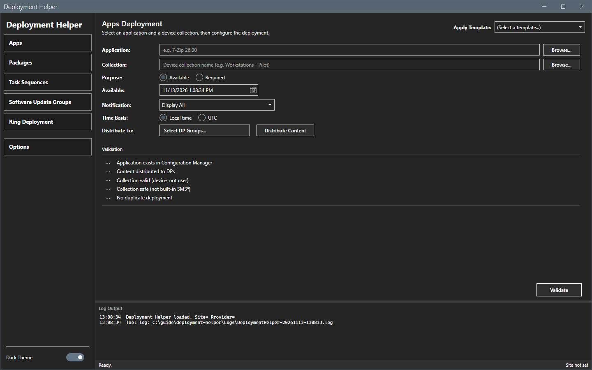
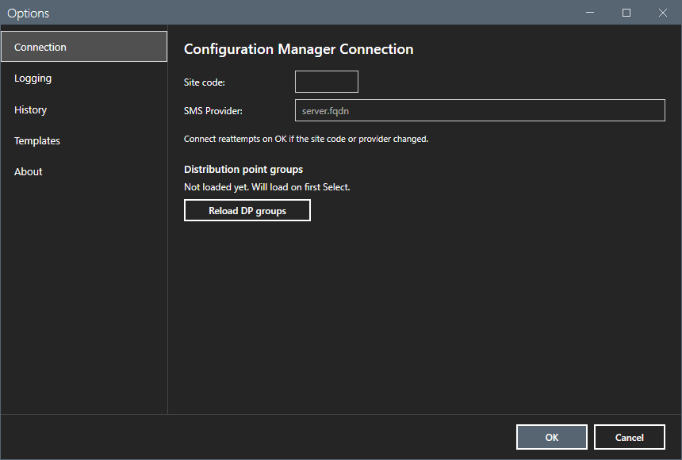
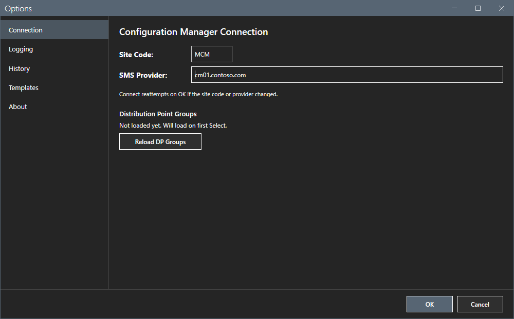

# Getting started

This page shows how to start Deployment Helper, set the connection and run a first check.

## What it does

The tool creates a Configuration Manager deployment of an application, a package, a task sequence or a software update group for a device collection. Before it creates the deployment, it runs five checks. It asks you to confirm and it writes one record to an audit log for each attempt.

## When to use it

Use it when you want a checked, logged deployment, or a ring deployment with one deployment for each ring.

## Requirements

- Windows 10 or Windows 11, PowerShell 5.1 and .NET Framework 4.8 or later.
- The Configuration Manager console. The tool loads the `ConfigurationManager` PowerShell module of the console. Without the console, the checks fail with a message in the log. See [Error messages](reference/error-messages.md).
- Configuration Manager rights to read the objects and to create deployments of the type that you use. See [Permissions](reference/permissions.md).

## Steps

### Start the tool

1. Extract the release zip to a folder that you can write to. The tool saves its settings, logs, templates and ring plans in that folder.
2. Right-click `start-deploymenthelper.ps1` and select **Run with PowerShell**. Or run this command:

```powershell
powershell -ExecutionPolicy Bypass -File start-deploymenthelper.ps1
```

The window opens on **Apps**. At the first start the tool writes four deployment templates to `Templates` and two ring plans to `Rings`.



### Set the connection

1. Select **Options** in the sidebar.
2. Type the **Site Code**, for example `MCM`.
3. Type the **SMS Provider**, for example `cm01.contoso.com`.
4. Select **OK**. The tool connects when the site code or the provider changed.

The footer of the window shows the saved values at the right end, for example `Site MCM · cm01.contoso.com`. Before you set them, it shows `Site not set`. The footer is read-only text. Select it to open **Options**. You change the site code and the SMS Provider only in **Options**.





### Run a first check

1. Type the name of an application in **Application**, or select **Browse...**.
2. Type the name of a device collection in **Collection**, or select **Browse...**.
3. Select **Validate**. The five checks run and show a check mark or a cross.

A check run changes nothing on the site. See [Application deployment](core/apps.md).

## Options and settings of this page

None. The settings are on [Options dialog](core/options.md).

## Limits

- The **Deploy** button shows only after all five checks pass.
- The tool blocks every collection whose ID starts with `SMS`.

## Troubleshooting

| Message or symptom | Cause | Fix |
|---|---|---|
| The log shows `Failed to connect. Check site code, provider, and ConfigurationManager module.` | The site code or the provider is wrong, or the console is missing, or `SMS_ADMIN_UI_PATH` does not point to the `bin\i386` folder of the console. | Check the connection. Install the console. If it is installed, set `SMS_ADMIN_UI_PATH` to its `bin\i386` folder and start the tool again. |

## Links

- [Application deployment](core/apps.md)
- [Options dialog](core/options.md)
- [Troubleshooting](troubleshooting.md)
