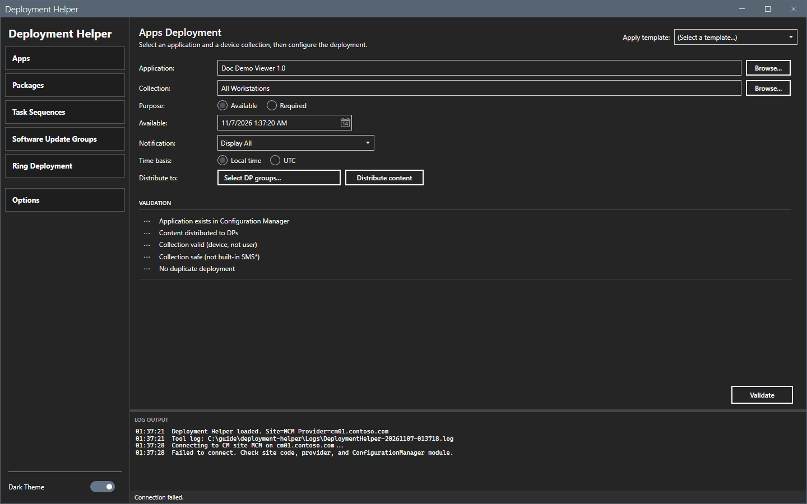

# Error messages

This page lists the messages of Deployment Helper with cause and fix. The messages show in the log pane, in the status bar and in dialogs.

## What it does

It maps a message to its cause and to a fix.

## When to use it

Use it when a check, a deployment or a ring run does not work.

## Requirements

None.

## Messages

| Message | Where | Cause | Fix |
|---|---|---|---|
| `Site code and SMS provider not set. Open Options > Connection.` | Log | The site code or the provider is empty. | Set both in **Options > Connection**. |
| `Failed to connect. Check site code, provider, and ConfigurationManager module.` | Log | The tool could not connect. The module is missing, or `SMS_ADMIN_UI_PATH` does not point to the `bin\i386` folder of the console, or the provider is wrong, or the account has no access. | Check the connection and the console. If the console is installed, set `SMS_ADMIN_UI_PATH` to its `bin\i386` folder and start the tool again. |
| `Application and Collection are required.` | Log | A field is empty. | Fill both fields. The messages for the other types name their object. |
| `Content not fully distributed: <n>/<m> DP(s) succeeded.` | Log | The content is not on all distribution points. | Distribute the content. |
| `Collection blocked: <reason>` | Log | The collection is built-in or not a device collection. | Select a custom device collection. |
| `Duplicate deployment already exists.` | Log | The object is already deployed to the collection. | Select another collection, or remove the old deployment. |
| `Duplicate check failed; deployment is blocked: <reason>` | Log | The duplicate check could not run. | Read the reason. Check the connection. |
| `Run Validate first.` | Log | **Deploy** ran before **Validate**. | Select **Validate**. |
| `Deployment cancelled by user.` | Log | You selected **Cancel** in `Confirm deployment`. | None. |
| `Deployment cancelled: schedule warning not confirmed.` | Log | You selected **No** in `Check deployment schedule`. | Correct the dates. |
| `Deployment blocked` | Dialog | The dates or the notification are not valid, or the audit log cannot be written. | Read the text of the dialog. |
| `Audit log write failed` | Dialog | The audit log path is not writable. | Set a writable path in **Options > Logging**. |
| `Package has <n> programs. Select one.` and `Select a program from the dropdown.` | Log | A package deployment needs a program. | Select the program in **Program**. |
| `Browse load failed: <reason>` and `Load error: <reason>` | Log, dialog | The list could not load. | Read the reason. Check the connection. |
| `Ring plan refused:` | Log | The plan has a rule error. | Read the text after the colon. |
| `Select a ring plan.` | Log | No plan is selected. | Select a plan. |

The image shows **Validate** on a computer without the console. The window stays open and the log names the cause.

## Steps

1. Find the message in the table.
2. Do the fix.
3. Run the action again.

## Limits

- The messages are in English.

## Troubleshooting

See [Troubleshooting](../troubleshooting.md).

## Links

- [Troubleshooting](../troubleshooting.md)
- [Permissions](permissions.md)
